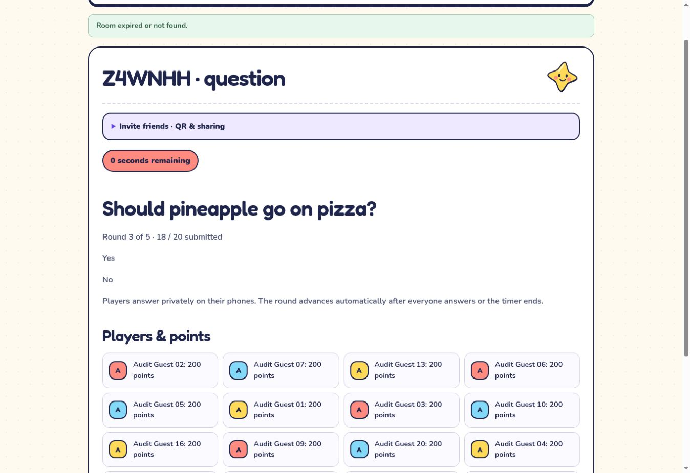

# Family game night readiness — October 26, 2026

## Verified environment

The owner previously confirmed Render **My Workspace**, `tea-dbeb9bo473hc73cogskg`, and free plans only. The service is [`trivia-lobby`](https://dashboard.render.com/web/srv-dbecn2nb9u1s7398u8j0), `srv-dbecn2nb9u1s7398u8j0`, serving <https://trivia-lobby.onrender.com/party/>. It uses one Free instance, branch `main`, manual deployments (`autoDeployTrigger: off`), and database readiness at `/health/ready`.

At first inspection, deploy `dep-dbfd7t2vcj2c73fmqm30` was already building commit `794b066a367657aaa0b51fa37eab73da9154140e`. It became live at 2026-10-26 04:16:48 UTC (12:16 a.m. Eastern). The readiness and liveness endpoints returned HTTP 200. Its exact commit had passing CI, production runtime and Chromium/Firefox/WebKit integrated acceptance. No new deployment was triggered by this audit.

During the browser test, another API-triggered deployment, `dep-dbfddctg1s2s73fce8d0`, replaced it with `b3d2296ae6c40103fd04234a36493a0f7a6431c0` (PR #62). Render records it live at 04:28:30 UTC (12:28 a.m. Eastern). The replacement and the old room's failure were both directly observed. Re-check current live commit before further testing; deployment state can change independently of this audit. A later follow-up inspection found deploy `dep-dbflvia9lscs73akqs2g` live on `6f384a5897d9b59d6d681e542e36cd7659dd672b` (PR #65) at 14:13 UTC (10:13 a.m. Eastern). That separate change added ten guest modes after the 20-browser test; the earlier 14-mode catalog observation describes its original tested commit, not this newer release. This PR is rebased on that newer main without adding games.

## Live guest evidence and its limits

- The live catalog showed all 14 guest games, including the 11 new family modes.
- Hosting Majority Rules produced a QR invitation and a direct `/party/?code=...` join link. Opening that link prefilled the correct six-character code.
- Ten, then twenty independent browser tabs joined using disposable audit nicknames. The host displayed exactly 20 connected guests.
- All 20 submitted round one and each received 100 points. A guest reload recovered the room, nickname and all scores; a host reload recovered the Next control.
- Round two also accepted all 20 and awarded 200 cumulative points to each player.
- The test did **not** complete: during round three the independent deployment replaced the server. Host and guest pages reported **Room expired or not found**, with the last view at 18/20 submissions. There is no verified final leaderboard for this live match.
- These are browser clients in a cloud browser, **not actual phones**. Camera QR scanning, iPhone/Android backgrounding, cellular/Wi-Fi changes and a full 10–20-phone match remain untested.



Guest rooms and credentials are in the process-local `Map` in `examples/party-engine/transport.js`; a redeploy/restart discards them. A browser refresh reconnects only while the original server still retains that room. Database snapshots and uploaded-file backups do not preserve active guest matches. Keep deployments frozen during game night. Render Free may also restart; it cannot guarantee uninterrupted active rooms.

## GitHub protection

GitHub's main-branch response reported `protected: false`; rulesets returned `[]`. The application connection cannot administer protection: its protection read returned HTTP 403 **Resource not accessible by integration**, and it exposes no protection/secret/variable write tools. The browser fallback reached a GitHub sign-in page, so account configuration requires secure sign-in.

[`script/github-main-protection.json`](../script/github-main-protection.json) supplies exact check contexts from the current workflows: `checks`, `production-runtime`, all three `postgres-and-browsers (...)` jobs, `engine-and-browsers`, `measured-single-instance`, and `blueprint`, plus the new `recovery-postgres18` fixture job. All are bound to GitHub Actions app 15368. It requires up-to-date tests, one approval, stale-review dismissal, an approval after the latest push, resolved conversations, and administrator enforcement; force pushes and deletion are blocked. The guest engine workflow must run on every PR, so this change removes its path filters. Workflow titles alone are not valid check contexts.

An authenticated repository administrator can apply the reviewed payload with:

```sh
gh api --method PUT repos/jimedusot-beep/Trivia-Lobby/branches/main/protection \
  --input script/github-main-protection.json
gh api repos/jimedusot-beep/Trivia-Lobby/branches/main --jq .protected
```

Verify the returned configuration, an unapproved PR being blocked, and checks being required before marking [#49](https://github.com/jimedusot-beep/Trivia-Lobby/issues/49) complete. An automated agent review is not an independent GitHub account's APPROVED review. Do not self-approve or merge this change without the requested independent approval.

## Backups and recovery

Neon project `broad-haze-37835050` (**Trivia lobby**), production branch `br-super-sea-b43utddf`, runs PostgreSQL **18.6** and has 19 public application tables. Its private `uploads` bucket and `library_files` table both contained zero objects/files at inspection. No private rows or credentials were exported during this audit.

The manual database snapshot `snap-summer-mud-b4r1p722`, `trivia-pre-release-safety-2026-10-25`, was re-listed. It is a same-provider database recovery point; neither an offsite copy nor an uploaded-file recovery drill.

The existing workflow was unsuitable for the current source: PostgreSQL 16 `pg_dump` cannot export a PostgreSQL 18 server; source and destination shared AWS environment values; the source Neon endpoint could influence the destination SDK; and an enabled job with no destination could create then delete its only archive. The proposed repair uses PostgreSQL 18 tools, separate source/destination configuration, explicit offsite preflight, unique encrypted objects and streamed length/SHA-256 readback. Manual bootstrap is allowed while daily scheduling remains disabled. Review also found an inherited restore hazard: production Neon settings could redirect restored originals back into the source bucket. Restores now require an explicit empty local destination, reject the source directory including symlink aliases, and strip source S3 settings. The native recovery drill checks inherited Neon settings and refusal to touch preexisting destination data. A new secret-free PostgreSQL 18 container job runs that drill on every PR, and production backup runs depend on it.

Follow [RECOVERY.md](RECOVERY.md) to configure a private independent destination, retention and recovery-key custody, then retrieve the offsite copy and restore into isolated PostgreSQL 18 and separate storage. **No real offsite archive, production restore, backup credential setup or daily schedule has been established by this code change.** Keep [#48](https://github.com/jimedusot-beep/Trivia-Lobby/issues/48) open. No billable resources were created.

## Automated verification

Local verification: five backup destination/integrity regressions plus two restore-storage isolation regressions; 82 application tests; TypeScript check; production build; dependency audit with zero vulnerabilities; 134 guest-engine tests on the refreshed main (the earlier pre-#65 baseline had 86). The guest suite includes all 11 new modes at 10 and 20 simulated clients, credentialed guest/host resume, server scoring, hidden information and next-round behavior.

The local environment cannot directly resolve the public WebSocket host, so the CLI public smoke could not complete; the live UI was exercised through the cloud browser instead. Native PostgreSQL tools and Playwright browser downloads were unavailable locally. Native encrypted restore and cross-browser acceptance must be established by this PR's CI, separately from real production recovery.

## Actual-phone acceptance sheet — pending

Use one visible host screen and 10 real player phones first, then 20. Include Safari on iPhone and Chrome on Android when available. Record date, live commit, phones/browsers, Wi-Fi and person running the test; avoid real email addresses or recovery tokens.

| Check | Pass criterion | Result |
| --- | --- | --- |
| QR camera scan | Each camera opens HTTPS invitation with correct room code | Pending |
| Join 10, then 20 | All nicknames appear once; nobody needs an account; 21st guest is refused | Pending |
| Start and host display | Host starts the intended mode; all phones see the same current phase | Pending |
| Locking and scoring | One accepted response per round; double tapping never awards twice; server totals match results | Pending |
| Guest refresh | Reload one phone mid-question, then after reveal: nickname and score survive | Pending |
| Guest background/network | Lock phone for 30 seconds; return; separately switch Wi-Fi/cellular and verify current state/score | Pending |
| Host refresh | Reload host: same mode/room/roster and correct host controls return | Pending |
| Deadline | Let one phone time out; others can continue, with no late score accepted | Pending |
| Final leaderboard | Finish a whole match; all 20 phones and host agree on scores and ties | Pending |
| Replay and original games | Return to lobby; play another mode and original Trivia Quiz, Prompt Duel and Charades | Pending |
| Longer session | Play for 30–60 minutes without deployments; record disconnects and recovery | Pending |

Stop the acceptance run if a deployment changes the live commit. The interrupted round does not count as a pass. Do not deploy a newer build until protection, independent review and verified recovery safeguards are ready.

## References

- [PostgreSQL 18 pg_dump compatibility](https://www.postgresql.org/docs/18/app-pgdump.html)
- [Render deployment lifecycle](https://render.com/docs/deploys)
- [Render HTTP readiness](https://render.com/docs/health-checks)
- [Repository cleanup history](REPOSITORY_CLEANUP_2026_10_25.md)
