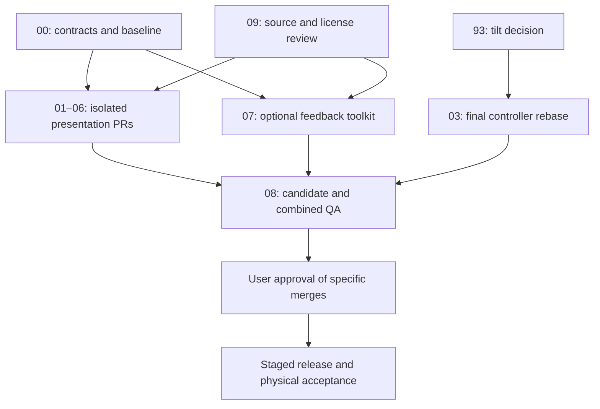

# Game Experience 2.0 integration plan

Audit date: October 29, 2026. Owner: Agent 00. Status: planning proposal; no release approval.

The television is the game; phones are simple controllers. Preserve account-free QR joining, private role projections, server authority, reconnect, checkpoints and every catalog entry. This PR changes documentation only. Agents 01–09 are assignments, not a claim that work has started.

## Pinned baseline and existing work

Branch all independent work from `main` at `55414cd7d3f8cc903897f5d40f3d0e914aea579b`, after fetching and checking that it is still current. If main moves, record the replacement SHA and review the diff before branching. Do not silently substitute an unmerged feature head.

- #90 and #92 are present in main's merge history: shared phone controllers and safe first-entry recovery already exist.
- Existing host Three.js scene, optional director camera, minimap, 2D fallback, hidden-tab pause, reduced motion, bounded render rate and GPU disposal are implemented. `docs/PARTY_GRAND_PRIX_3D.md` remains useful but its “before implementation” heading is historical.
- The catalog already has categories, selected-game preview, player-count descriptions and local Fredoka/Nunito fonts. Extend rather than rebuild those features.
- Drawing has a dedicated renderer and disposal path; Homeward, poker and Family Showdown have isolated renderers. Use their existing context arguments.
- Catalog inspection via importing `guestGames` confirms **31 IDs**: quiz, duel, charades, majority, likely, closest, survey, impostor, percentage, category, bingo, caption, timeline, bracket, turbo, wave, homeward, trails, no-say, tap, race, feud, draw, colors, four, chess, checkers, reversi, mancala, table, backgammon. This is an inventory, not proof that every game passed browser acceptance. Preserve per-game active-seat limits; 20 room members does not mean 20 poker seats.

### Open PR review queue

Snapshot from GitHub on the audit date; recheck before integration.

| PR | Observed state | Integration treatment |
| --- | --- | --- |
| [#93 tilt](https://github.com/jimedusot-beep/Trivia-Lobby/pull/93) | Open, not draft, mergeable; head `cdc9cce43b869d520253148fc22c3b384ac156d2` | Reserve tilt files; do not duplicate. Six PR-triggered workflow runs report success. Physical motion permission/feel remains unverified. |
| [#84 combined reliability](https://github.com/jimedusot-beep/Trivia-Lobby/pull/84) | Open | Separate candidate integrating #81–83 on an older baseline. Rebase/compare against current main and rerun acceptance before recommending it. |
| [#81 countdown settings](https://github.com/jimedusot-beep/Trivia-Lobby/pull/81) | Open | Covered by #84 proposal; do not also merge blindly. |
| [#82 bounded queues](https://github.com/jimedusot-beep/Trivia-Lobby/pull/82) | Open | Covered by #84 proposal; no UI agent edits to delivery semantics. |
| [#83 projection CPU](https://github.com/jimedusot-beep/Trivia-Lobby/pull/83) | Open | Covered by #84 proposal; function benchmark is not host FPS evidence. |

#93 reserves `race-ui.js`, `phone-controller.css`, new `race-tilt.js`, `browser-specs/race-tilt.spec.js`, `test/race-tilt.test.js` and `docs/TILT_RACING.md`. Its returned mergeable status is a snapshot, not permission to merge. Verified workflow runs: guest 40811622550, load 40811622718, blueprint 40811622648, CI 40811622739, backup 40811622523, platform 40811622568. Workflow success does not prove an actual production backup or physical-device test.

## Ownership and collision rules

Paths below are relative to `examples/party-engine/` unless fully qualified. A new file belongs to its named owner; ownership of a renderer does not grant ownership of its shared caller.

| Agent / branch | Exclusive write scope | Dependencies and required coordination |
| --- | --- | --- |
| 00 / `planning/game-experience-2-integration` | This roadmap and `docs/GAME_EXPERIENCE_2_RELEASE_CHECKLIST.md` | Documentation only in this PR. Review shared-file patch proposals; do not edit game runtime here. |
| 01 / `feature/gx2-race-visuals` | `render/race-3d-scene.js`, new `render/gx2-race-*` helpers, `public/race.css`, new race assets | Keep existing scene API; `public/race-ui.js` reserved for #93 then a separate coordinated adapter patch. |
| 02 / `feature/gx2-tv-lobby` | `public/game-catalog.js`, `game-catalog.css`, `lobby-theme.css`, new `public/gx2-catalog-*` | Sole writer of global theme token definitions; other agents consume tokens only. |
| 03 / `feature/gx2-phone-ux` | `public/phone-controller.js`, `phone-controller.css`, `browser-specs/phone-controllers.spec.js` | CSS blocked by #93 decision. JS audit can proceed on baseline; final controller branch rebases after approved #93 merge or coordinates a minimal compatible patch if deferred. |
| 04 / `feature/gx2-game-show` | `public/feud-ui.js`, `show.js`, `show-format.js`, `social-ui.js`, new `public/gx2-show.css` | Shared CSS/import hook proposed to 00; no `pack-ui.js` editing. |
| 05 / `feature/gx2-drawing` | `public/drawing-ui.js`, new `public/gx2-drawing.css`, new drawing-specific specs | Preserve private word and draft/stroke lifecycle; shared controller changes go to 03. |
| 06 / `feature/gx2-tabletop` | `public/homeward-ui.js`, `homeward.css`, `homeward-geometry.js`, `poker-ui.js`, new `public/gx2-tabletop-*` | Preserve seat/spectator rules; request shared import hooks. |
| 07 / `feature/gx2-feedback-kit` | New `public/gx2-feedback-*` modules/demo/specs | Audit existing `client/src/lib/game-audio.ts` consumers first; no edits there without a separate agreed patch. No game renderer hooks in toolkit PR. |
| 08 / `test/gx2-performance-qa` | New `browser-specs/gx2-*` specs, new QA scripts/reports under `script/gx2-*` and `docs/measurements/gx2-*` | Avoid specs owned by 03/#93; runtime fixes go in separate owner-reviewed PRs. |
| 09 / `audit/gx2-open-source-provenance` | `docs/OPEN_GAME_SOURCES.json`, provenance report, license inventory and notices | Only central manifest writer. Feature agents supply proposed entries alongside assets; 09 consolidates verified entries. |

Protected shared files: `public/app.js`, `index.html`, `style.css`, `pack.css`, `pack-ui.js`, `pack-config.js`, build scripts, package manifests/locks, protocol, `server/guest-party.ts`, checkpoint code and `racing.js`. No unilateral edits. Submit a patch proposal naming file, exact hook, owner, ordering and tests. Agent 00 records agreement, and a separate integration implementation PR applies it after dependencies are approved. Preserve both sides of semantic changes; never resolve a conflict by taking an entire file from one branch.

## Renderer integration contract

Keep existing entrypoints; this plan does not introduce a second renderer framework or network stack.

1. **Input:** render only the current role-filtered state received by the existing client. Never fetch hidden answers, hands or deck state for animation. Never infer scoring, legal moves, round outcome or survey points in the renderer.
2. **Lifecycle:** mount into the supplied root/content through existing callers. Update an existing active renderer where supported. Cancel timers, RAF, audio, DOM listeners, pointer capture and pending async completions on phase/match change and disposal. Cleanup must be safe twice. Reconnect renders current truth without replaying old celebrations or submitting actions.
3. **Actions:** call existing `action`/`play`/`sendInput` adapters and respect `canAct`, pending state, role and connection readiness. Do not create sockets or ACK before durable commit. Cosmetic animation cannot block a valid action or make its result authoritative.
4. **Race API (existing):** `createRaceScene({onContextLost})` returns `{canvas, render, dispose, setCamera}`. Preserve `render(frame, previous, interpolation, now, reducedMotion)` and the existing camera mode meanings. `race-ui.js` owns frame validation by match/heat, host-only dynamic import, RAF and 2D switching. Scene code consumes coordinates; it does not change physics. On WebGL loss call the existing fallback callback; avoid room reload. Retain 30 Hz paint cap, capped pixel ratio/size, bounded effects and resource disposal. Phones must never request `race-3d.bundle.js`.
5. **Other APIs (existing):** preserve `renderPack(state, context)`, `renderFeud(state,{root,e,b,play,input,canAct})`, `renderDrawing(state,{e,b,play,refresh,canAct,getPack})`, `renderHomeward(state,{root,e,b,play,refresh,canAct})`, and the actual `renderPoker` context in its caller. Keep `disposeDrawing`, drawing busy/draft protection and Homeward clock updates. Do not force a new signature across these modules.
6. **Phone wrapper:** preserve `mountPhoneController(state,{actor,game,releaseControls})` and disposal. Game renderers supply content, not a competing full-page shell. Neutralize held race inputs on blur, dialogs and disconnect; #93 extends this to stale motion.
7. **Async presentation:** tag effects with match/round/phase and a local generation token; cancel stale effects after navigation. For feedback toolkit, propose an optional event API with event identity, mute/volume, cancellation and user-gesture unlock. This is a design requirement for 07, not an implemented API.
8. **Loading:** self-host assets under current CSP, support standalone `/` and production `/party/` mounts, preserve local notices and source download. No CDN, remote font request or additional service.

## Visual contract and host/phone boundary

Reuse current Sakura identity: `--lobby-paper` #fff5e9, `--lobby-ink` #241c44, `--lobby-muted` #57506d, `--lobby-violet` #5142a1, mint #86cfb2, gold #ffdb88; `--font-display` Fredoka and `--font-body` Nunito. Agent 02 owns any additions to `lobby-theme.css`. Other modules use scoped roots and fallback values, avoiding global button/body overrides. New selectors use a game root or `gx2-<owner>` prefix. Do not replace existing tokens globally from another branch.

Proposed acceptance targets: host at 1920×1080 with question/round headings around 40–64 CSS px and key scores at least 28 px, checked for overflow and viewing distance; phone text at least 16 px and primary touch targets at least 44×44 CSS px. Check actual contrast, focus visibility and non-color cues rather than treating these values as certification. Reduce decorative motion under `prefers-reduced-motion`; no flashing celebration. Keep sounds optional and unlocked by interaction.

TV owns shared scene, question, revealed answers, timer, roster, scores and QR invitation. Phone owns only the current player's action/private information, connection state and secondary dialogs. Test 320×480 portrait, 568×320 short landscape and 844×390 landscape, safe areas and virtual keyboard. Primary controller actions must fit without document scrolling; dialogs must remain navigable with long text and keyboard open. Preserve touch fallback for tilt.

## Dependency graph and proposed merge order

1. Review 00 and 09 first; do not make unverified assets a dependency. License findings may block reuse without blocking original CSS/procedural work.
2. Resolve #93 separately. Prefer reviewing it before the final phone UX patch; if deferred, leave tilt untouched and document missing tilt compatibility evidence. No automatic merge.
3. Review 07's isolated toolkit and 02's shared token/catalog changes, then 01, 04, 05 and 06 individually, then 03 after its tilt dependency is resolved. This is the default smallest-shared-surface-first sequence; actual PR size/failures may change it in the tracker.
4. Add optional sound/import hooks only in a separate small integration PR after provider and consumer APIs are reviewed. No mandatory dependency on audio for gameplay.
5. 08 compares baseline, each candidate and a disposable combined checkout. Record all source SHAs. Combined test checkout is not main and is not a deployment. Rebase remaining branches after each approved merge; rerun affected checks on the resulting head.
6. Evaluate #84 or its constituent fixes separately against current main. Do not claim their old baseline measurements apply to GX2. Any approved runtime change requires new combined recovery/load evidence.
7. Request approval with concrete PR URLs, test results and outstanding risks. Merge only specifically approved PRs. Deployment requires separate approval and a known-good artifact/rollback target.

## Compatibility and evidence gates

Common root commands: `npm ci`, `npm run check`, `npm test`, `npm run build`. Guest commands from `examples/party-engine`: `npm ci`, `npm test`, `npm run test:browser -- --project=chromium`; use `PARTY_CROSS_BROWSER=1 npm run test:browser -- --project=firefox` and equivalent WebKit after browser installation. CI uses Node 22; local audit uses Node 24.22.1. Root `npm run test:e2e` and `npm run test:integration` require their configured application/database environment; use integrated-platform workflow for the full production artifact/PostgreSQL gate. Do not run database migrations against production as a test.

| Change | Focused acceptance |
| --- | --- |
| Catalog | `pick-a-game`, `sakura-catalog`, `mobile-host-invite`, QR/entry recovery; all 31 IDs accessible and launchable within their limits |
| Race | `racing`, `race-3d`, `race`, `connection-recovery`; 2/10/20 racers, context loss, phones without 3D, full heat/results/return; tilt specs after #93 |
| Phone | `phone-controllers`, `entry-recovery`, representative social, drawing, poker, Homeward, touch/tilt; dimensions above |
| Game show | `social`, `open-pack`, privacy/role tests; server reveal order and scores survive reconnect |
| Drawing/tabletop | `open-pack`, `homeward`, controller specs; drafts, bounded strokes, private words/hands, legal moves, side pots and spectators |
| Feedback | New isolated mute/unlock/dedupe/cancel tests; then targeted consumer tests for each approved hook |
| Combined | Full three-browser guest/platform workflows, load/recovery workflows, root check/test/build and new 08 evidence |

Agent 09 runs `npm run audit:licenses` in a clean tree, reviews its generated inventory diff, checks actual pinned upstream licenses and separately licensed art/sound, and verifies credits/source-download paths. The root MIT declaration does not override AGPL-marked game files or adapted board code. No upstream source/assets are imported by this planning PR.

Every visual PR supplies same-state before/after host and phone captures, viewport/browser/commit identifiers, reduced-motion checks, file and bundle sizes, relevant timings and known limitations. Agent 08 reports simulated 2/4/10/20 joins, frame-time distributions, network/input indicators and cleanup; record machine/GPU and compare equivalent runs. No fabricated FPS or physical-device claims. Physical iPhone/Android tilt and a workplace 10–20-phone Wi-Fi session remain explicit release gates, not CI results.

## PR evidence tracker

Only 00 is being executed in this assignment. Fill actual PR/head/CI links after creation; “pending” never means passed.

| Agent | PR / head | CI / compatibility | Visual / source evidence | Conflicts / release status |
| --- | --- | --- | --- | --- |
| 00 | This planning PR; branch above | See checklist audit record | Source inspection; no runtime/art changes | Documentation only; approval pending |
| 01 | Pending | Pending | Pending race captures/benchmarks/provenance | Shared race adapter reserved |
| 02 | Pending | Pending | Pending catalog captures | Sole theme token writer |
| 03 | Pending | Pending | Pending controller captures/manual card | #93 CSS dependency |
| 04 | Pending | Pending | Pending reveal/privacy evidence | Shared imports reserved |
| 05 | Pending | Pending | Pending stroke/draft evidence | Shared controller reserved |
| 06 | Pending | Pending | Pending move/hand privacy evidence | Shared imports reserved |
| 07 | Pending | Pending | Pending API/sound provenance | No consumer hooks yet |
| 08 | Pending | Pending | Pending baseline/candidate report | No runtime edits |
| 09 | Pending | Pending | Pending verified license menu | Sole manifest writer |

## Rollback and integration handoff

Before each approved merge record main SHA, PR head and resulting artifact identity. Keep releases small. If acceptance fails, stop the sequence, retain logs and revert the individual integration/feature commit through a reviewed revert PR; do not force-push main or revert another agent's whole file. Revert sound consumer hooks before the toolkit if dependent. Race must retain selectable 2D fallback. For deployment, preserve the known-good artifact and restore it only through the approved release procedure; frontend rollback does not imply checkpoint/database rollback. This plan adds no schema migrations.

Changed files: this roadmap and release checklist only. Dependencies: none added. APIs: existing signatures documented, no runtime changes. Conflict risks: other planning work in these two docs; future runtime collisions listed above. Verification: review source anchors, catalog inventory, PR status and checklist; runtime gates apply again to each implementation PR. Nothing here establishes release readiness.
