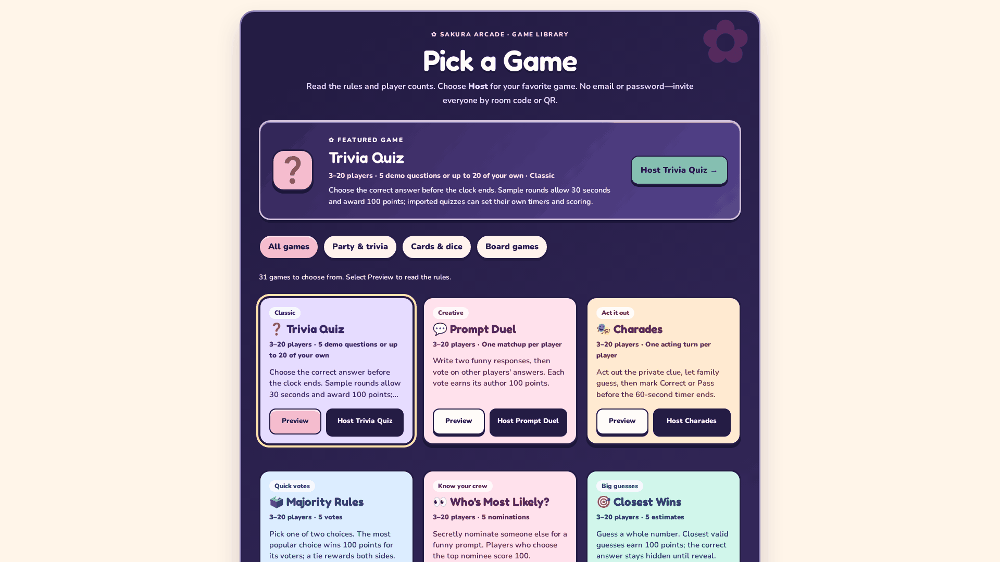
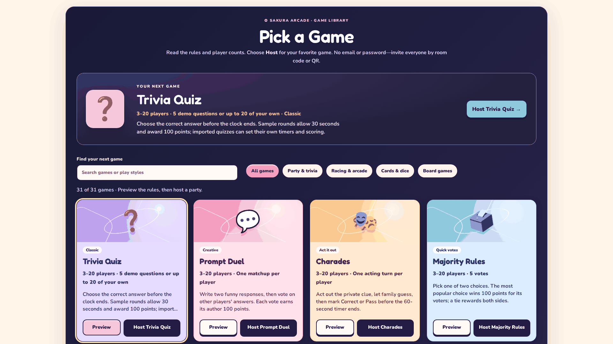

# GX2 TV library and lobby handoff

Base: main `55414cd` (2026-10-29). Separate branch `feature/gx2-tv-lobby`.
At inspection #90/#92 were merged; #93 tilt and #94 integration plan remained open. No dependency on either open branch. No merge or deployment performed.

## Changes and ownership

- `game-catalog.js/css`: original decorative game covers using existing icons, larger selected-game presentation, wider TV shelf, search, live result counts, racing/arcade category and empty state. Existing 31 IDs and both host/lobby callbacks preserved.
- `lobby-theme.css`: scoped wide-screen room heading/invitation sizing, excluding active phone controllers. No shared index/app/style edits.
- `browser-specs/tv-catalog.spec.js`: catalog interaction, every launch callback, keyboard host launch, viewport/overflow and reduced-motion checks; reproducible baseline capture.
- `OPEN_GAME_SOURCES.json`: pinned reference provenance.

No API, protocol, server, dependency, game-state or account changes. Coordinate future catalog changes with Agent 02; Agent 01 renderer work and #93 controller files are disjoint. Existing account-free QR and room invitation remain in use. Revert this PR to roll back presentation; no migration.

## Before / after

Before: narrow text-card shelf, category filters and emoji previews. After: wide illustrated shelf, readable badges, search plus dedicated racing filter, larger preview and wide-screen invitation text. Small screens retain a vertically scrollable *landing catalog*; in-game phone controller CSS is unchanged.

Additional checked screenshots: [desktop](evidence/gx2-tv/desktop.png), [320px landing](evidence/gx2-tv/small.png), [host lobby](evidence/gx2-tv/lobby.png).

## Validation

- `npm run check`: pass.
- `npm test`: 111 passed, 0 failed/skipped (repeated after provenance update).
- `npm run build`: pass; existing >500 kB application chunk warning remains.
- `npm test --prefix examples/party-engine`: 253 passed, 0 failed/skipped.
- `CHROMIUM_EXECUTABLE_PATH=/tmp/gx2-chrome/chrome-headless-shell-linux64/chrome-headless-shell npx playwright test --config examples/party-engine/playwright.config.js tv-catalog mobile-host-invite --reporter=line`: 8 passed, 0 failed/skipped. Google Chrome for Testing headless shell 156.0.8078.47.
- `git diff --check`: pass.

System Chromium could not launch due to a process-singleton socket restriction. Playwright's browser download was truncated; official Google headless shell resolved execution. These were environment launch failures before app tests. Screenshots visually inspected at 1920px and 320px; a narrow preview column found at 320px was changed to a single column and rechecked.

Performance observations: no external image fetches, no new JS dependencies, no animation loop, only bounded filtering over 31 existing entries. CSS artwork uses static gradients and transforms; reduced motion removes hover motion. This is not a measured TV GPU/frame-rate claim. Physical TV viewing distance, physical phones, Firefox/WebKit, full platform/database acceptance and all-game end-to-end play remain unverified; focused Chromium coverage launches Grand Prix and checks all 31 IDs in both picker modes.

## Sources and license inventory

MATAH `IACBI/matah` at `049da257eb690e82d7c47d1f2d502b607adb054a`: root LICENSE is MIT, copyright 2026 A.C.B. README TV/phone concept and Home.tsx guest entry studied only; no code/assets imported, no asset license reliance. Original CSS compositions reuse catalog emoji rendered by the platform and already bundled Fredoka/Nunito OFL fonts. No blanket relicensing of existing AGPL-marked modules.

## Review / integration

Inspect screenshots, rerun focused tests with a working Chromium executable, check every category/search reset and keyboard Preview/Host, then open a QR invitation at 320px. Existing invitation remains collapsible by the host. Catalog retains all entries through filters/search rather than introducing a new carousel or pagination system. No synthetic loading delay was added: catalog data is synchronous/local. Main changes after this base require normal rebase/conflict review. CI must pass before any later merge decision.
