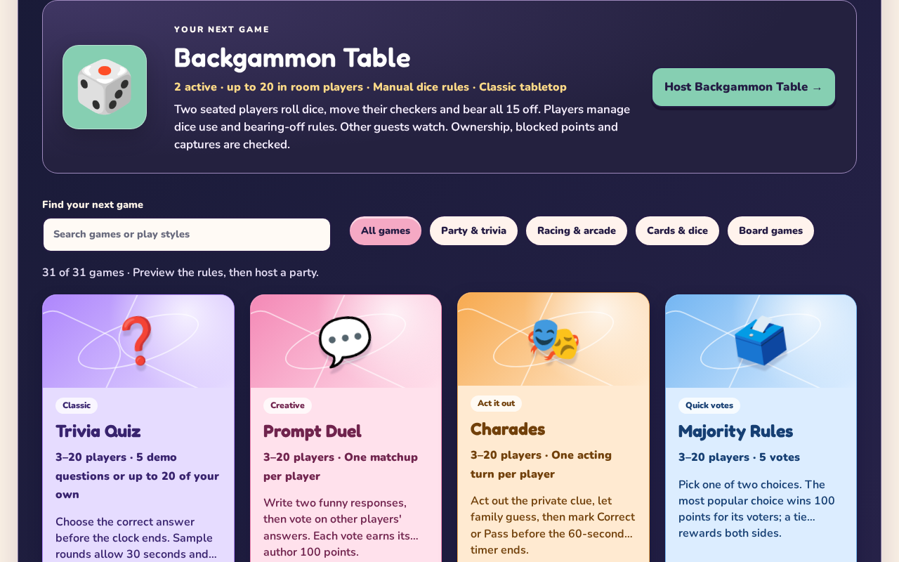
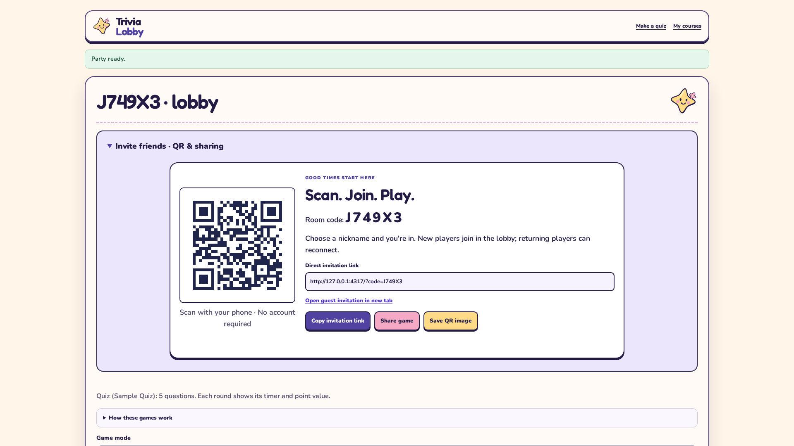

# TV screen follow-up fixes

Base: main `48e6f9198ce39926ac7048d2f8efac338de6e0ab`. Branch: `fix/tv-preview-lobby-scope`.

## Behavior

- Before: Preview on a lower game card changed rules above the viewport. After: explicit Preview activation focuses the rules heading and scrolls the panel into view; reduced motion uses instant scrolling. Automatic search/filter preview updates do not move focus or scroll. Tab advances from the heading to Host.
- Before: creating a room shrank the 1560px catalog shell to a 1050px lobby. After: host lobbies at widths >=1100px keep the 1560px maximum; smaller viewports retain existing layout.
- Before: TV invitation rules excluded only standard phone controllers. After: TV rules require lobby phase and host mode selector, excluding standard and racing controllers. Active game layouts retain existing widths/type sizes.

## Validation

- `npm run check`: passed.
- `npm test`: 111 passed, 0 failed/skipped.
- `npm test --prefix examples/party-engine`: 259 passed, 0 failed/skipped.
- `npm run build`: passed; existing application large-chunk warning.
- `CHROMIUM_EXECUTABLE_PATH=/tmp/tv-fix-chrome/chrome-headless-shell-linux64/chrome-headless-shell npx playwright test --config examples/party-engine/playwright.config.js tv-catalog mobile-host-invite --reporter=line`: 12 passed, 0 failed/skipped.
- After adding screenshot capture only, repeated two new cases with `--grep 'lower-card|TV lobby width'`: 2 passed, 0 failed/skipped. Screenshots visually inspected.
- `git diff --check`: passed.

Official Chrome for Testing headless shell 156.0.8078.47 used after system Chromium launch failure. New tests check lower-card rules visibility/focus/Tab flow, wide lobby maximum, and controller/active-phase CSS exclusions. Controller class/phase exclusion assertions are synthetic CSS checks; invitation and preview flows use the actual app.

No assets imported, external asset requests, dependencies, server/protocol changes, or license changes. Existing source/license inventory remains applicable. No new animation loop; one focus/scroll operation per explicit Preview. No measured physical-TV performance claim.

## Integration and limits

Changed owned catalog JS, lobby theme CSS, TV browser spec, and this evidence document. No shared app/index/global CSS edits. Host identification uses the existing lobby-only #mode selector plus phase; if that DOM contract changes, update the scoped selectors/tests. Revert this PR to roll back; no migration. Physical TV/phone and local Firefox/WebKit testing remain unverified. CI must validate the new head. No merge/deployment performed.
